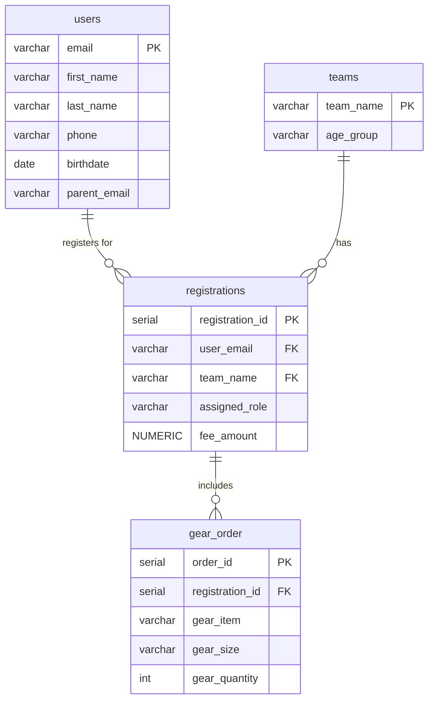

# Lab 7 Solutions

**Student Name:** Jennifer Njogu
**Student ID:** 01256232
**Date:** 10/15/26

---

## Ticket 1: The Visual Audit (Physical ERD)
*Complete the physical architecture diagram below. Refer to `MERMAID_CHEAT_SHEET.md` and Ticket 1 in `IN_CLASS_LAB.md` for attribute details.*

